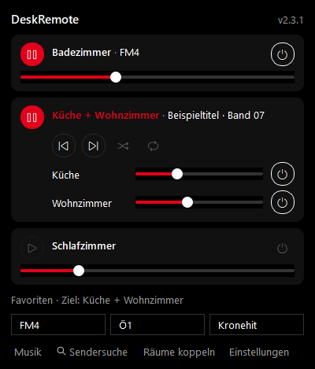

# DeskRemote

**Inoffizielle Windows-Fernbedienung für Teufel Raumfeld** – lebt im Infobereich der Taskleiste: Räume, Lautstärke, Favoriten, Internetradio und die Musik vom NAS, ohne das Handy zu zücken.

*Unofficial Windows tray remote for Teufel Raumfeld multi-room speakers. UI in German or English – picked from your Windows language on first start, switchable under Settings → Language.*



> DeskRemote ist ein privates Hobbyprojekt und steht in keiner Verbindung zur Lautsprecher Teufel GmbH. „Teufel“ und „Raumfeld“ sind Marken ihrer jeweiligen Inhaber und werden hier nur verwendet, um zu beschreiben, mit welchen Geräten das Programm zusammenarbeitet.

## Was es kann

- **Räume & Gruppen:** alle Räume mit Lautstärke, Play/Pause und Standby; Räume koppeln und entkoppeln.
- **Favoriten = Teufel-Favoriten:** DeskRemote zeigt und spielt dieselbe Favoritenliste wie die Teufel-App. Was man in DeskRemote mit ☆ anlegt, steht auch in der App, und umgekehrt. Ein Klick oder Strg+Alt+1–3.
- **Sendersuche** über TuneIn, direkt über die Anlage (wie in der Teufel-App), mit Senderlogos.
- **Musik vom NAS:** Alben, Künstler, Ordner und Suche in der Raumfeld-Bibliothek, mit Covern; Zufall und Wiederholen.
- **Spotify-Anzeige:** spielt Spotify Connect, zeigt DeskRemote das Spotify-Icon und (im Mehrraum-Modus) Titel und Interpret.
- **Globale Tastenkürzel** und ein Rechtsklick-Menü am Taskleistensymbol.
- **Deutsch oder Englisch:** beim ersten Start nach der Windows-Sprache, umstellbar in den Einstellungen (gilt nach Neustart).

## Voraussetzungen

- Windows 10 oder 11.
- Eine Teufel-Raumfeld-Anlage (Streaming-Lautsprecher, die die Teufel-/Raumfeld-App steuert) im selben Heimnetz.
- Zum Bauen aus dem Quellcode: Python 3.13.

## Herunterladen und starten

1. **[`DeskRemote.exe` herunterladen](https://github.com/zabern/deskremote/releases/latest)** (unter „Assets“) und an einen festen Ort legen. Keine Installation, kein Python nötig.
2. Doppelklicken. Das Symbol erscheint unten rechts (ggf. unter „ausgeblendete Symbole“ – zum Anheften in die Taskleiste ziehen).
3. Beim ersten Start warnt Windows SmartScreen, weil die exe nicht signiert ist: **„Weitere Informationen“ → „Trotzdem ausführen“**.

Wer lieber selbst baut: siehe „Bauen und Testen“; direkt aus dem Quellcode geht auch `.venv\Scripts\python -m deskremote`.

**Linksklick** aufs Symbol: Räume, Lautstärke, Play/Pause, Standby, Favoriten, Suche.
**Rechtsklick**: Favoriten, Alle pausieren, Einstellungen, Beenden.
**Raumnamen anklicken** = Ziel-Raum (rot) für Favoriten, Suche und Tastenkürzel.

## Musik vom NAS

- Voraussetzung: den Musikordner des NAS **einmal in der Teufel-App** als Musikquelle hinzufügen. Raumfeld liest ihn dann selbst ein.
- Im Ausklappfenster **„Musik“**: Künstler (Start), Alben, Ordner, Suche. ▶ beim Album spielt das ganze Album, ▶ beim Titel ab diesem Titel, ▶ beim Künstler alle seine Titel im Zufallsmodus – jeweils im Ziel-Raum bzw. der Ziel-Gruppe.
- **☆** legt Album, Titel oder Künstler in den Teufel-Favoriten an (auch in der Teufel-App sichtbar).
- Weitere DLNA-Server im Heimnetz erscheinen ebenfalls als Quelle (ob Raumfeld deren Alben abspielt, hängt vom Server ab).

## Spotify

- Gesteuert wird Spotify über die Spotify-App; DeskRemote zeigt nur an, wo Spotify gerade spielt.
- Im **Mehrraum-Modus** (Teufel-App → Spotify) gibt es genau ein Spotify-Gerät, die „Spotify-Zone“. Koppelt man in DeskRemote Räume, die zur Spotify-Zone gehören, wandert Spotify mit. Im **Einzelraum-Modus** ist jeder Raum ein eigenes Spotify-Gerät.

## Teufel-Favoriten

- Die Liste liegt auf der Anlage, nicht in DeskRemote. Neue Favoriten landen oben, wie in der Teufel-App.
- **Löschen** in den Einstellungen entfernt den Favoriten nach einer Rückfrage auch in der Teufel-App.
- **Umsortieren und Umbenennen** kann die Anlage nicht; die Knöpfe sind dafür gesperrt.
- **Strg+Alt+1–3:** In den Einstellungen festlegen, welcher Favorit auf welchem Kürzel liegt. Ohne Festlegung gilt Platz 1–3 der Liste. Beim Umstieg übernimmt DeskRemote die bisherige Belegung, wo der Sender eindeutig wiederzufinden ist, und meldet die übrigen.
- Die frühere eigene Liste bleibt in der Config erhalten und gilt nur, bis die Anlage einmal erreichbar war.

## Bekannte Grenzen

- **HLS-Sender** (Adressen mit `.m3u8`, z. B. alle BBC-Sender) kann Raumfeld nicht abspielen. DeskRemote schickt solche Adressen aus alten eigenen Favoriten nie an die Anlage; TuneIn-Sender löst die Anlage selbst auf.
- Senderlogos im SVG-Format werden aus Sicherheitsgründen nicht angezeigt (siehe Sicherheit).

## Tastenkürzel (Standard, in den Einstellungen änderbar)

| Kürzel | Wirkung |
|---|---|
| Strg+Alt+↑ / ↓ | Lautstärke Ziel-Raum ±5 |
| Strg+Alt+Leertaste | Play/Pause Ziel-Raum |
| Strg+Alt+1 / 2 / 3 | Favorit 1–3 im Ziel-Raum |
| Strg+Alt+0 | Ziel-Raum in Standby |

## Daten und Datenschutz

DeskRemote hat kein Konto, keine Werbung und sendet keine Nutzungsdaten. Netzwerkverkehr gibt es nur hier:

| Ziel | Wann | Was wird gesendet |
|---|---|---|
| Raumfeld-Anlage im Heimnetz | immer | Steuerbefehle (UPnP, Host-API Port 47365) |
| Raumfeld-Anlage → TuneIn | Sendersuche | Suchbegriff (die Anlage fragt TuneIn) |
| radio-browser.info | Logos alter eigener Favoriten | Stream-Adresse |
| Logo-Adressen der Sender | Favoriten mit Logo | normaler Bildabruf |
| MusicBrainz / Cover Art Archive | fehlende Cover, **abschaltbar** | nur Interpret und Albumname |
| last.fm (über die Raumfeld-Anlage) | Künstlerbilder | Bildabruf nach Weiterleitung der Anlage |

Gespeichert wird lokal: `%APPDATA%\DeskRemote\config.json` (Zwischenspeicher der Teufel-Favoriten, Kürzel-Belegung, Tastenkürzel, Ziel-Raum, Host-Adresse), `%APPDATA%\DeskRemote\deskremote.log` (Befehle an die Anlage, max. ~1,5 MB) und ein Cover-Zwischenspeicher unter `%LOCALAPPDATA%\DeskRemote\covers`.

## Sicherheit

Zwei Sicherheits-Audits liegen bei: [Lauf 1](docs/security-audit-2026-11-13.md), [Lauf 2](docs/security-audit-2026-11-15.md). Kurz: Texte aus dem Netz werden nie als HTML angezeigt, Bilder nur als Rasterformate geladen, Netzwerkantworten gehärtet geparst (defusedxml), Weiterleitungen eng begrenzt. Wie jede UPnP-Steuerung vertraut DeskRemote den Geräten im eigenen Heimnetz.

Sicherheitslücken bitte nicht öffentlich als Issue melden, sondern über GitHubs „Report a vulnerability“ (Security-Reiter).

## Bauen und Testen

```powershell
python -m venv .venv
.venv\Scripts\python -m pip install -e ".[dev]"
.venv\Scripts\python -m pytest -q
powershell -ExecutionPolicy Bypass -File .\build.ps1   # -> dist\DeskRemote.exe (~28 MB)
```

`DeskRemote.spec` lässt beim Bauen ungenutzte Qt-Teile weg (Software-OpenGL, QML, PDF, SVG, Übersetzungen …).

## Technik in Kürze

- Host-API der Raumfeld-Anlage auf Port 47365 (`getZones` mit Long-Polling, `listDevices`, `connectRoomsToZone`, `dropRoomJob`), Host-Suche per SSDP.
- Wiedergabe, Lautstärke und Standby per UPnP (AVTransport, RenderingControl) am Zonen- bzw. Lautsprecher-Renderer; Musikbibliothek per ContentDirectory.
- Python 3.13, PySide6 (Qt 6), httpx, defusedxml; Paket als PyInstaller-Einzeldatei.

## Lizenz

[MIT](LICENSE) – ohne Gewähr. Benutzung auf eigene Verantwortung.
